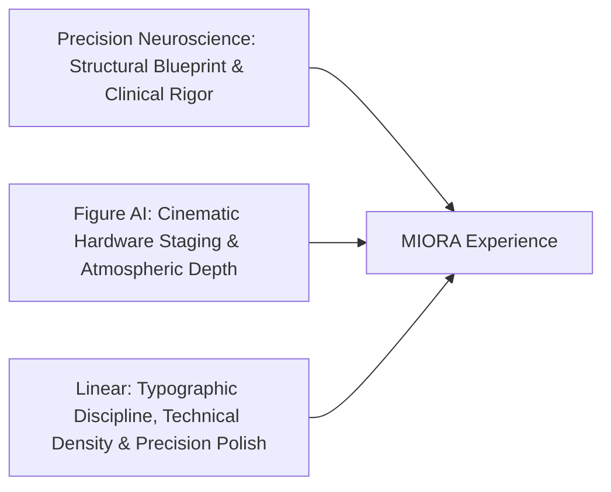
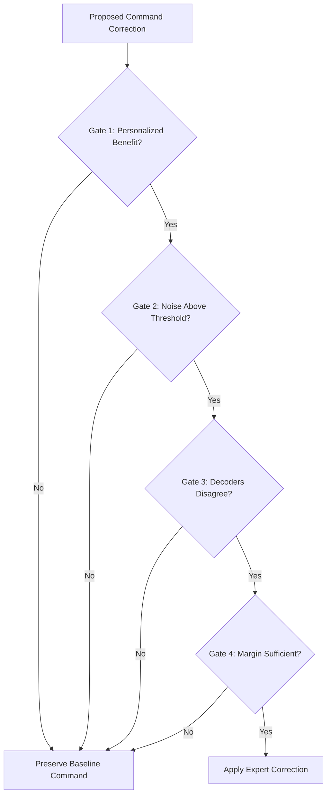

# MIORA — Design Decisions & Architectural Mapping

> **Project**: MIORA — Neural Signal Integrity  
> **Tagline**: *"Protecting the signal. Preserving the intent."*  
> **Secondary Description**: *"An experimental decision-protection layer for more reliable brain–computer interfaces."*  
> **Language**: Kazakh (primary) with English technical & branding terms.  
> **Document Date**: 2026-10-26

---

## 1. Design Philosophy & Triad Synthesis

1. **Structural Foundation (Precision Neuroscience)**:
   - High-contrast monochromatic hierarchy (Deep space `#050608` with neural ice silver `#d7e2e9` and cyan synaptic accents `#00e5ff`).
   - 8-stage progressive scroll narrative moving from clinical macro-challenge down to micro-algorithmic solution and verified empirical data.
2. **Cinematography & Staging (Figure AI)**:
   - Central interactive 3D hero object (neural cortical model with live synaptic impulses).
   - Dynamic viewport framing that reacts with subtle parallax to user scroll and pointer trajectory.
3. **Visual & Typographic Discipline (Linear)**:
   - Monospace precision badges (`[GATE_01 // AUTHORIZATION]`, `[EEG_CH: 08-64]`).
   - Clean micro-borders (`border border-white/10`), ultra-refined cards with border beam sweeps, zero arbitrary neon gradients.
4. **Absolute Scientific Integrity**:
   - Clear disclosure: Offline research prototype evaluated on 9 participants with semi-synthetic chewing contamination. Not a cleared medical device. No inflated clinical claims.

---

## 2. Section-by-Section Architectural Mapping

| Section | Narrative Goal | Visual Metaphor | Component / Library Integration |
| :--- | :--- | :--- | :--- |
| **01 — Hero** | Immediate visceral impact; introduce MIORA and its core mission | High-precision interactive 3D Brain with glowing synaptic fiber trails | Custom Three.js / R3F Brain Geometry + React Bits Ghost Fibers + Morphin Text Shimmer |
| **02 — The Problem** | Explain jaw muscle (EMG) chewing artifact corrupting EEG brain signals | Clean sinusoidal EEG signal devolving into chaotic high-frequency jitter on scroll | Seer.js Harmonic / Waves + React Bits Liquid Ether noise distortion |
| **03 — Introducing MIORA** | The conceptual reveal: MIORA as an intelligent decision-protection layer | Signal passes into a protective quantum isolation matrix | Morphin Scroll Scramble + Libraries.dev Thinking Orbs |
| **04 — How MIORA Works** | Step-by-step interactive disclosure of the 4 verification gates | Command packet travelling sequentially through 4 security airlocks / gates | Morphin SVG Branch Connector + Libraries.dev Border Beam + 4 Gate Cards |
| **05 — Interactive Demo** | Hands-on simulator allowing user to toggle chewing noise and test cascade | Live oscilloscope + dynamic gate status + real-time decision outcome | Custom React Audio/Wave Simulator + Precision Slider + Gate LED Indicators |
| **06 — Scientific Results** | Transparent empirical proof: 38.5% → 32.4% error, 4.7% → 3.9% weak HARM | Animated metric counters, comparative delta bar charts, participant breakdown | Morphin Dashboard Performance Chart + Animated Counters + Confidence Intervals |
| **07 — Research & Next Steps** | Academic grounding, open datasets, methodology, and MIORA-2 outlook | Clean research terminal / documentation view with dataset provenance | Structured Linear-style research disclosure layout with methodology citations |
| **08 — Team & Footer** | Authentic recognition of student researchers, supervisor, and institution | Minimalist team profile cards + high-contrast institutional footer | NIS Almaty-Nauryzbay affiliation, Bekarys Qydyrbek, Erbosyn Shaimardan, Kalima Qabylbek |

---

## 3. The 4 Decision-Protection Cascade Gates (Scientific Logic)

Every BCI command proposed under chewing interference must pass four strict gates before MIORA permits a baseline override:

1. **Gate 1 — Personalized Authorization (Жеке бейімделген авторландыру)**:  
   *Condition*: The auxiliary expert model must have demonstrated statistically significant benefit for this specific participant on prior training splits.
2. **Gate 2 — Noise Energy Threshold (Жоғары жиілікті шу деңгейі)**:  
   *Condition*: Observed high-frequency EMG muscle power (40–100 Hz band) exceeds the empirically calibrated baseline noise floor.
3. **Gate 3 — Decoder Disagreement (Декодерлер сәйкессіздігі)**:  
   *Condition*: The baseline decoder and the auxiliary expert propose conflicting command outputs (\( \hat{y}_{base} \neq \hat{y}_{expert} \)).
4. **Gate 4 — Expert Confidence Margin (Сенімділік маржасы)**:  
   *Condition*: The classification probability margin of the expert exceeds the baseline decoder's confidence by at least \(\Delta_{margin}\).

---

## 4. Visual Identity & Design System

### Palette
- **Deep Void (Background)**: `#050608`
- **Neural Platinum (Primary Foreground)**: `#d7e2e9`
- **Synaptic Cyan (Active Accent / Signal Integrity)**: `#00e5ff`
- **EMG Interference Amber (Artifact / Noise Flag)**: `#ffab00`
- **Protection Emerald (Passed Gate / Protected Command)**: `#00e676`
- **Borders & Dividers**: `rgba(215, 226, 233, 0.12)`

### Typography (Tailwind & Web Fonts)
- **Headings & Brand**: `Space Grotesk` / `Geist Sans` with negative letter-spacing (`tracking-tight`).
- **Quotes & Emphasized Truths**: `Instrument Serif` / `Playfair Display` italic.
- **Data, Gates, Status Readouts**: `JetBrains Mono` / `Geist Mono` (`tracking-wider text-xs uppercase`).
