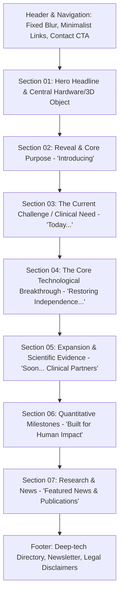

# Precision Neuroscience — Structural & Architectural Analysis

> **Source**: [https://www.precisionneuro.io/](https://www.precisionneuro.io/)  
> **Role**: Primary Structural Blueprint for the MIORA website.  
> **Inspection Date**: 2026-10-26  
> **Screenshots captured**:  
> - Desktop Full-page: `research/screenshots/precision_desktop_full.png` (1440x8700px, 788 KB)  
> - Mobile Full-page: `research/screenshots/precision_mobile_full.png` (390x9800px, 542 KB)

---

## 1. Visual Narrative & Philosophy

Precision Neuroscience's website is the gold standard for clinical-stage neurotechnology communication. It does not look like a generic SaaS landing page, nor does it look like a dry academic PDF. Instead, it balances:
1. **Clinical Authority & Rigor**: Muted grayscale palette (deep blacks, slate grays, ice platinum `#d7e2e9`), precise mono badges, and uninflated claims.
2. **Cinematic Hardware Reveal**: Central 3D imagery of the actual cortical array, ultra-fine electrode details, macro photography, and clean dimensional layering.
3. **Restrained Editorial Typography**: High-contrast grotesk headers paired with editorial serif quotes and monospace technical readouts.
4. **Section-by-Section Rhythm**: Alternating dark atmospheric canvases with crisp inverted modules, large-scale typography, and progressive scroll disclosure.

---

## 2. Typography System

| Role | Font Family | Equivalent / Fallback | Usage in Precision |
| :--- | :--- | :--- | :--- |
| **Display / Headings** | `fff-acid-grotesk` | Inter / Space Grotesk / Geist | Hero headline, section titles, primary statements. Tight tracking (`-0.03em`), bold weights (600-700). |
| **Editorial Accents** | `immortel-colera` | Instrument Serif / Playfair Display | Patient stories, philosophy quotes ("I want innovation that is also inclusive..."). |
| **Technical / Monospace**| `abc-monument-grotesk-mono` | JetBrains Mono / Geist Mono | Section numbering, category badges, technical specifications, electrode counts. |
| **Body Copy** | Acid Grotesk / Inter | Inter / Geist Sans | High readability, 16px - 18px on desktop, 1.5 line-height, muted contrast (`#999` to `#ccc`). |

---

## 3. Color Architecture & Design Tokens

```css
:root {
  /* Surfaces */
  --color-black: #050608;
  --color-surface-dark: #0c0e12;
  --color-surface-card: #12151b;
  --color-surface-elevated: #181c24;
  --color-white: #ffffff;

  /* Brand & Accents */
  --color-brand-primary: #d7e2e9;   /* Neural platinum / ice silver */
  --color-brand-secondary: #00e5ff; /* Cyan electrical impulse */
  --color-brand-tertiary: #49555c;  /* Slate steel */

  /* Neutral scale */
  --color-gray-dark: #1f242d;
  --color-gray-medium: #4a5260;
  --color-gray-light: #9ba3af;
  --color-gray-extra-dark: #757575;

  /* Strokes & Borders */
  --color-scheme-stroke-primary: rgba(255, 255, 255, 0.12);
  --color-scheme-stroke-secondary: rgba(215, 226, 233, 0.2);

  /* Motion */
  --transition-duration: 0.28s;
  --transition-ease: cubic-bezier(0.16, 1, 0.3, 1);
}
```

---

## 4. Section Sequence & Structural Breakdown

The homepage DOM structure consists of 7 primary groups inside `sections-module-scss-module__fUt1Xq__container`:



### Detailed Group Topology

1. **Header & Navigation**:
   - Fixed sticky bar with backdrop blur (`backdrop-filter: blur(16px)`).
   - Left: Wordmark / Logo.
   - Center: Minimal navigation (`Technology`, `Clinical`, `Company`, `News`).
   - Right: High-contrast pill CTA (`Partner With Us` / `Contact`).

2. **Group 0 — Hero Section**:
   - Massive full-viewport display statement: *"The brain-computer interface that will change everything"*.
   - Central prominent visual: High-detail 3D bio-compatible cortical interface floating in deep space.
   - Micro-metric labels and mono badges floating alongside key structural features.
   - Clean scroll indicator anchoring the bottom edge.

3. **Group 1 — The Reveal ("Introducing")**:
   - Seamless background transition with subtle gradient lighting.
   - Large introductory typography revealing the breakthrough module (Layer 7).
   - High-contrast visual focus on electrode density and non-damaging mechanical properties.

4. **Group 2 — The Problem & Purpose**:
   - Framing statement: *"Today, our system is designed to help people with paralysis operate digital devices using only their thoughts."*
   - Explains the critical gap in existing invasive devices (craniotomy risk, scar tissue, signal loss).

5. **Group 3 — Architectural Deep-Dive**:
   - *"Restoring independence and connection for millions"*.
   - Multi-layer visual breakdown: skull, dura mater, cortical surface, micro-electrode contact.
   - Editorial patient/clinical quote block with high-contrast serif typography.

6. **Group 4 — Expansion & Clinical Partners**:
   - Dual-column architecture:
     - Left: Future horizon (*"Soon, it will expand to more regions of the brain..."*).
     - Right: Verified institutional clinical partners (academic medical centers, health systems).

7. **Group 5 — Hard Data & Impact Metrics**:
   - *"Built for human impact"*.
   - Quantitative milestone grid: 1,024 electrodes, micron thickness, zero tissue penetration.
   - Regulatory transparency and FDA designation status clearly cited.

8. **Group 6 — Research & News**:
   - Grid of latest technical publications, scientific press, and clinical updates.
   - Direct links to research papers and methodology.

9. **Footer**:
   - Clean, dark architectural footer.
   - Newsletter registration with discreet inline inputs.
   - Legal disclaimers clarifying regulatory status and research boundaries.

---

## 5. Mobile vs Desktop Responsive Adaptations

- **Hero Layout**: Single-column flex on mobile (<768px), font-size steps from `clamp(2.5rem, 7vw, 5.5rem)` down to `clamp(1.8rem, 5vw, 2.8rem)`.
- **3D Canvas**: Centered with scaled camera FOV and touch drag rotate enabled.
- **Data Grids**: Desktop 3-4 column grid converts into clean vertical card stacks with border separators.
- **Sticky Elements**: Header collapses into a clean mobile overlay drawer with accessible button tap targets (minimum 44x44px).
